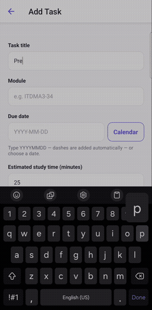
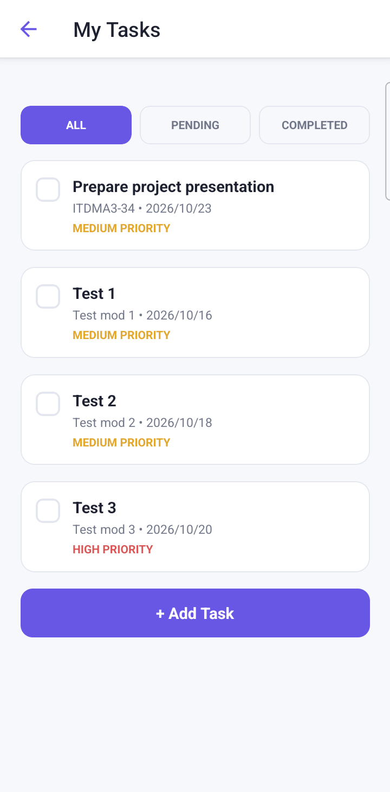
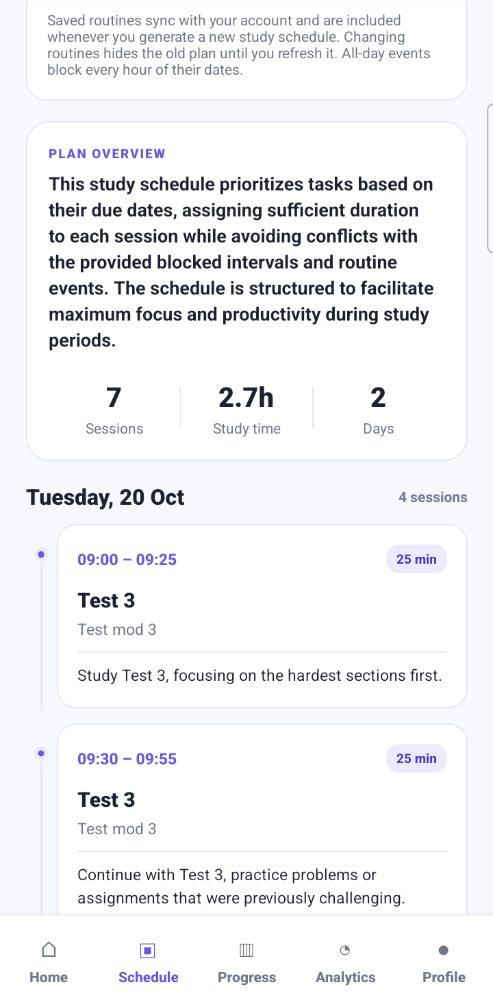
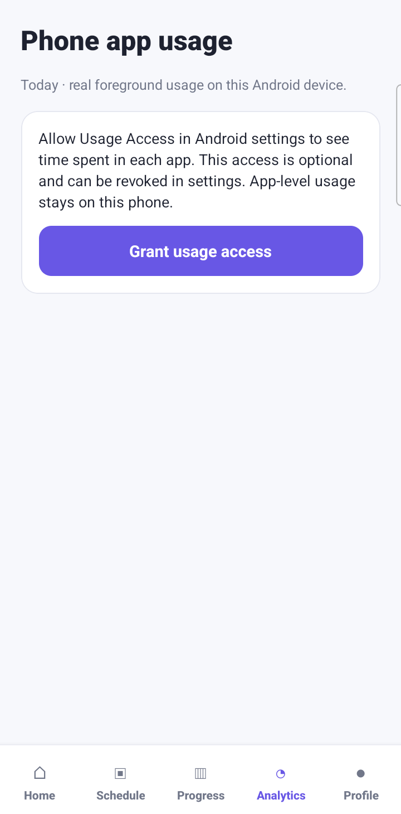
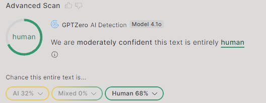

# StudySmart AI

A study planner built for ITDMA3-34 by Group 9. Students add deadlines and regular activities, then generate a study timetable around the time they have available.

The app uses React Native and Expo, with a FastAPI backend. OpenAI can generate the plan; a local scheduler handles requests when no API key is configured or the AI response cannot be used.

## Demo

[](docs/demo/studysmart-demo.mp4)

[Watch the 74-second recording](docs/demo/studysmart-demo.mp4). It shows adding a task, refreshing the schedule, completing the task, and checking usage analytics on an Android phone.

## What works

- Add, edit, delete, and complete tasks, with deadlines, priorities, difficulty, and estimated study time.
- Save one-off or recurring activities, including overnight events and all-day holidays.
- Generate study sessions around those activities and the selected daily study window.
- Read Android app usage after permission is granted, and change app categories locally.
- Request study suggestions using entertainment minutes and pending tasks, with a separate opt-in.
- Save study preferences, switch themes, and schedule local deadline reminders.
- Sign in with Google on Android. The browser version uses a demo account.
- Store tasks, routines, and schedules in JSON or PostgreSQL. JSON is the local default.

The progress screen counts completed tasks. Its study streak and achievement messages are still placeholders. Usage categories are editable keyword matches; they do not establish whether someone was studying.

Task, routine, and schedule routes accept a client-supplied user ID and an optional shared test token. They need verified user authentication before the service can hold real student data. Google token verification is implemented separately for usage suggestions. See the [backend notes](backend/README.md) for the current access model.

## Screenshots

| Tasks                                | Schedule                                   | Analytics                                    |
| ------------------------------------ | ------------------------------------------ | -------------------------------------------- |
|  |  |  |

## How scheduling works

The backend places sessions before task deadlines, inside the daily study window, with breaks and without activity conflicts. It checks generated plans before saving them. If the AI response fails validation, the backend uses the local scheduler. When work cannot fit, the response includes warnings about the remaining study time.

Saved schedules include the activities used to build them. Changing an activity hides the old plan until it is regenerated, so the app does not keep displaying a timetable based on outdated availability.

## Repository layout

| Folder                    | Contents                                                                                    |
| ------------------------- | ------------------------------------------------------------------------------------------- |
| `frontend/`               | React Native screens, state, API clients, and the native Android project                    |
| `backend/`                | FastAPI routes, scheduling, storage, and Python tests                                       |
| `android-usage/`          | Usage-tracking documentation and Java tests; the bridge itself lives in `frontend/android/` |
| `database/`               | Storage notes                                                                               |
| `infrastructure/railway/` | Hosting setup notes                                                                         |
| `docs/`                   | Demo recording and screenshots                                                              |

## Run locally

### Backend

Use Python 3.11 or later. From the repository root in PowerShell:

```powershell
cd backend
python -m venv .venv
.venv\Scripts\Activate.ps1
python -m pip install -r requirements.txt
Copy-Item .env.example .env
uvicorn app.main:app --reload --port 8000
```

Leave `OPENAI_API_KEY` empty to use the local scheduler. The API documentation is at `http://localhost:8000/docs` while the service is running. PostgreSQL configuration and migration instructions are in [backend/README.md](backend/README.md).

### Android app

Use Node.js LTS, the Android SDK, and a connected phone or emulator. In a second terminal:

```powershell
cd frontend
npm install
Copy-Item .env.example .env
```

Set `EXPO_PUBLIC_API_BASE_URL` in `frontend/.env`:

| Device                  | API URL                                                                |
| ----------------------- | ---------------------------------------------------------------------- |
| Android emulator        | `http://10.0.2.2:8000`                                                 |
| Phone over USB          | `http://127.0.0.1:8000`, after running `adb reverse tcp:8000 tcp:8000` |
| Phone on the same Wi-Fi | `http://<computer-LAN-IP>:8000`                                        |

Then build and launch:

```powershell
npm run android
```

Google sign-in requires the build's signing SHA-1 to be registered for the OAuth client. Follow [Google authentication setup](frontend/docs/GOOGLE_AUTH_SETUP.md) when building on another machine.

Usage access and reminders require a native build. Expo Go cannot load the manually integrated usage module. Avoid `expo prebuild --clean`, which removes that integration. See [Android usage setup](android-usage/README.md) and [settings](frontend/docs/settings.md) for device checks.

For a browser preview, run `npm run web`. It uses the demo account and the same backend; Android usage data is unavailable there.

### Checks

Backend, from `backend/`:

```powershell
python -m pip install -r requirements-dev.txt
python -m pytest
```

Frontend, from `frontend/`:

```powershell
npm run typecheck
npm test
```

These cover application logic and types. Sign-in, usage permissions, and notification delivery also need checks on an Android device. The Java accumulator test command is in [android-usage/README.md](android-usage/README.md#checks).

## API

| Method                 | Route                    | Purpose                                             |
| ---------------------- | ------------------------ | --------------------------------------------------- |
| `GET`                  | `/health`                | Service status                                      |
| `GET`, `POST`          | `/tasks`                 | List or create tasks                                |
| `GET`, `PUT`, `DELETE` | `/tasks/{id}`            | Read, update, or delete a task                      |
| `PATCH`                | `/tasks/{id}/status`     | Change task status                                  |
| `GET`, `PUT`           | `/routines`              | Load or save activities                             |
| `GET`                  | `/schedule`              | Load the saved schedule                             |
| `POST`                 | `/schedule/generate`     | Generate a schedule                                 |
| `POST`                 | `/api/usage/suggestions` | Suggest study blocks from the supplied usage budget |

See the [task and schedule contract](frontend/docs/API_CONTRACT.md) and [usage endpoint notes](backend/README.md#android-usage-suggestions) for request details.

## Remaining work

- Verify Google identity on task, routine, and schedule routes, and handle expired sessions in the app.
- Replace the progress screen's fixed streak and achievement messages with recorded activity.
- Repeat the device checks for sign-in, usage access, and reminders before assessment.

## Team

| Members           | Area                                         |
| ----------------- | -------------------------------------------- |
| Taiwo and Emma    | Mobile interface and Google sign-in          |
| Kobus and Callen  | Calendar, backend, storage, and hosting      |
| Johan and Maritza | Android usage tracking and study suggestions |

## Text scan result


